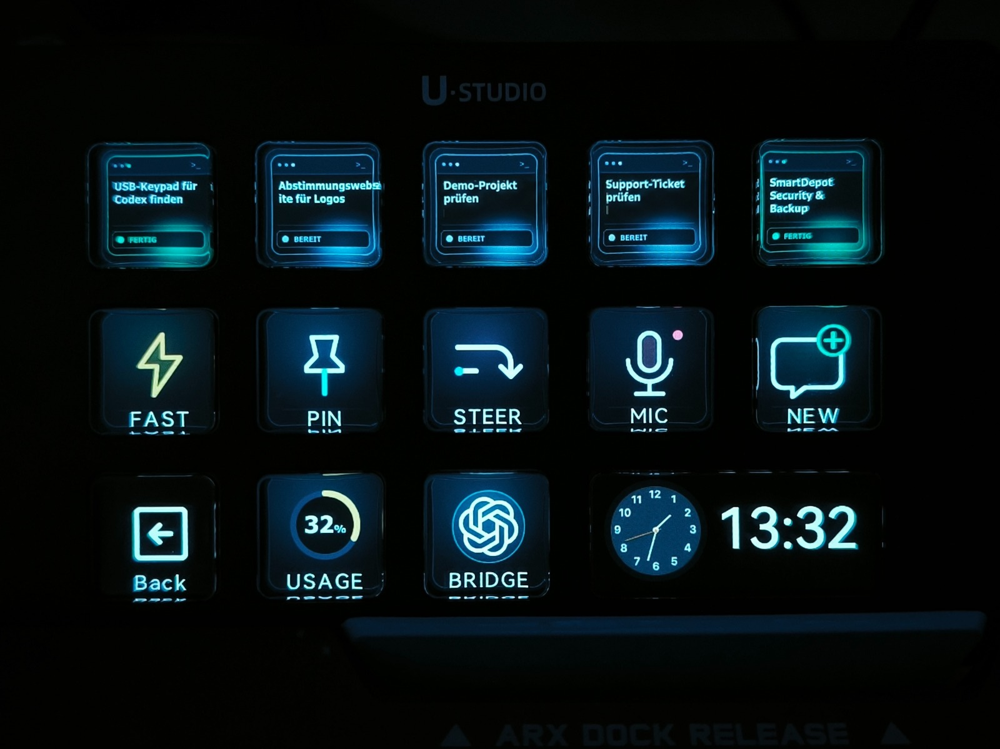
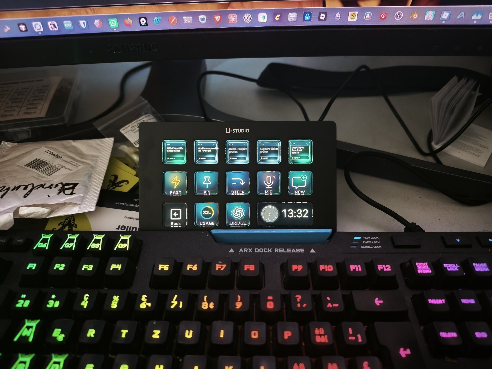
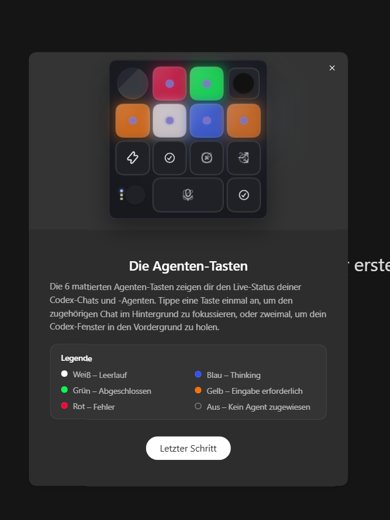

# OpenCodexMicro for Windows and Ulanzi D200

Control Codex Desktop from a Ulanzi D200 through Ulanzi Studio on Windows
10/11. This independent **abartiggut Windows port** is published in a
[development repository](https://github.com/abartiggut/ulanzi) and a
[GitHub-registered fork](https://github.com/abartiggut/OpenCodexMicro).
Both use `windows-port` as the default branch. The installation commands below
clone the development repository.

**Start here:** [Install on Windows](#install-on-windows) ·
[Agent installation checklist](docs/windows-agent-install.md) ·
[Windows troubleshooting](docs/setup-and-operations.md#windows-1011-experimental)

OpenCodexMicro exposes Codex's live Micro state through a loopback Bridge and
turns it into a native Ulanzi Studio plugin. It shows recent tasks, switches to
the exact task displayed on a key, and provides Fast, Usage, Pin, New, Fork,
Steer, Mic, Submit, Latest Task & Scroll, and Model & Reasoning Encoder actions.

## Install on Windows

### Requirements

- Windows 10/11 with Codex Desktop installed.
- Ulanzi Studio 3.4.8 or later and a connected Ulanzi D200 Series.
- Git and Node.js 20 or later.

Save any Ulanzi Studio profile changes, then quit Studio completely, including
its tray process. Open PowerShell and run:

```powershell
git clone --branch windows-port https://github.com/abartiggut/ulanzi.git
cd ulanzi
npm ci
npm run setup:windows
```

This builds and installs **Codex Micro** into the current user's Ulanzi Studio
plugins and installs the local Bridge in `%LOCALAPPDATA%\OpenCodexMicro`.
`npm run setup` is the macOS installer; use `npm run setup:windows` here.

Restart Ulanzi Studio. In the **Codex Micro** action category, assign
**Codex Task 1–5** to five keys and **Launch Codex Bridge** to another key.
The German Studio labels are **Codex-Aufgabe 1–5** and **Codex Bridge starten**.
Press the Bridge key. It starts Codex with the required local connection and
may first close a Codex instance that was already running. If you are following
these steps inside Codex itself, save your work before pressing that key.

Check the connection in PowerShell:

```powershell
Invoke-RestMethod http://127.0.0.1:17373/health
```

The response should contain `service: OpenCodexMicro` and
`codexConnected: true`. If the Bridge key has not yet been assigned, start
Codex through the installed launcher:

```powershell
powershell.exe -NoProfile -ExecutionPolicy Bypass -File "$env:LOCALAPPDATA\OpenCodexMicro\launch-codex.ps1"
```

The key layout is configured in Ulanzi Studio; no profile is bundled. To open
the Codex page from a main-deck key, use Studio's **Pages → Go to Page** action
and select the page containing **Launch Codex Bridge**.

**For an AI agent:** follow [AGENTS.md](AGENTS.md) and the
[Windows agent installation checklist](docs/windows-agent-install.md). They
cover existing installations, exact action IDs, language settings, Bridge
routes and verification without guessing.

## Language and key controls

Ulanzi Studio's interface language selects the plugin's action names. The
plugin includes English, German, Spanish, Portuguese, Japanese, Korean and
Chinese translations. German task cards show German status labels; other
supported Studio languages currently show English task-card statuses. There
is no npm language flag. Codex Desktop's language is independent of Studio's.

Ulanzi Studio receives the physical key press, the Codex Micro plugin sends
the action to the local Bridge, and the Bridge controls Codex Desktop. The
[action and command table](docs/windows-agent-install.md#how-keys-control-codex)
lists every key, encoder, stable action ID and local route.

## See it running



The Windows setup on a desk, with the D200 showing the same live task keys:



The chat titles on task keys 3 and 4 are anonymized in both photographs. Task
keys show the current chat title and a color-coded written status: idle,
working, done, input needed or error. Offline is shown separately. The
matching function icons and Codex mark are in the
[icon set preview](docs/icon-set-preview.png). Run `npm run icons:generate` to
rebuild the 196 × 196 px assets.

Codex Desktop's Windows onboarding screen explains the agent key status colors
(this screenshot shows an earlier key design):



## What it does

| Feature | Behavior |
| --- | --- |
| Five live task actions | Show Codex's Most Recent tasks with idle, working, complete, pending approval, reply needed, or error state |
| Exact task switching | Route the selected thread through Codex's own Micro event bus |
| Codex controls | Fast, Usage, Pin, New, Fork, Steer, Mic, and Submit |
| Launch Codex Bridge | Start or restart Codex on Windows with local CDP |
| Encoder navigation | Press to open task 1; turn left/right to scroll up/down through Ulanzi Studio's hotkey protocol |
| Model & Reasoning Encoder | Turn to switch models; hold and turn to switch reasoning effort; stop at either end of each list |
| Context Navigator Encoder | First turn opens the + / @ menu; turn left/right to move up/down; click to select, hold and turn to close; clicking while closed does nothing |
| Permission Pilot Encoder | Turn to change the active chat's permission policy; during approval, select ONCE / CHAT / DENY and press to submit |
| Live usage | Draw the remaining Codex allowance directly on the key; press to return to Codex |
| Ulanzi Studio integration | Let Ulanzi Studio own the device and manage the key layout |
| Local-only transport | Bind CDP and the Bridge API to loopback addresses only |

This independent fork extends Ulanzi's unofficial Codex Desktop integration to
Windows. The original project targets macOS and Ulanzi D200 Series. Neither
Ulanzi nor OpenAI maintains or endorses this fork.

Ulanzi's implementation and maintenance scope is limited to
`integration/com.ulanzi.codexmicro.ulanziPlugin/`. The plugin only consumes
state and action interfaces exposed through the existing local Bridge; Ulanzi
did not participate in the design, specification, development, or maintenance
of CDP or Codex's CDP implementation. See [NOTICE.md](NOTICE.md) for the full
responsibility boundary.

## Configure

The physical layout is managed in Ulanzi Studio. The plugin ships these
actions: Codex Task 1–5, Fast, Usage, Pin, New, Fork, Steer, Mic, Submit, and
Latest Task & Scroll, Model & Reasoning, and Context Navigator for Encoder controls.
No separate device daemon or shortcut mapping is required.

Select any configured action to open the shared **Codex Bridge Setup** page.
It shows Bridge installation, service, and CDP status and provides Install /
Repair and Launch controls.

The Model & Reasoning action uses the active composer's available model list
and the selected model's supported reasoning efforts. Right turns toward the
highest entry (Codex's first model), left toward the lowest (its last model).
Holding and turning right/left raises/lowers reasoning effort. Neither list wraps.
The graphic display separates model version and family, shows list position and
effort bars, and highlights reasoning while held. Pressing alone changes no selection.
Rebuild/update the Bridge as well
as the plugin when upgrading to this feature (use Install / Repair in the setup page).

Task keys mark pending approval and pending replies explicitly while keeping the
task title. They return to their normal status when Codex resumes or completes.

Context Navigator controls the composer's **Add files and more** (+ / @) menu.
The first turn opens it without skipping the initial selection. Further left/right
turns move up/down. A click confirms the highlighted item on release; holding
and turning either way closes the menu without confirming. Clicking or holding
and turning while the menu is closed does nothing. It uses structural identifiers rather than translated
button labels. Update both the plugin and Bridge when adding this feature.

See [Configuration](docs/configuration.md) for action behavior and layout
guidance.

## Documentation

- [Windows installation for AI agents](docs/windows-agent-install.md)
- [Windows setup and troubleshooting](docs/setup-and-operations.md#windows-1011-experimental)
- [Configuration](docs/configuration.md)
- [Architecture](docs/architecture.md)
- [Engineering constraints](docs/errors.md)

## macOS and the original project

The original [UlanziTechnology/OpenCodexMicro](https://github.com/UlanziTechnology/OpenCodexMicro)
project targets macOS. Its installation uses different commands and a
`Codex Bridge.app`. See this fork's [macOS operations](docs/setup-and-operations.md#macos)
or the [Chinese README](README_zh.md) for that platform. The Windows commands
at the top of this page install the abartiggut development repository.

## GitHub repositories

- [abartiggut/ulanzi](https://github.com/abartiggut/ulanzi) is the Windows
  development repository used by the installation commands above.
- [abartiggut/OpenCodexMicro](https://github.com/abartiggut/OpenCodexMicro)
  publishes the same `windows-port` branch as a GitHub-registered fork, so it
  appears in the original project's fork list. No pull request to the original
  project is needed to use either repository.

## License

Project-authored code is released under the [MIT License](LICENSE). See the
[modification and responsibility notice](NOTICE.md) for upstream attribution,
material changes, Ulanzi maintainership, independence from OpenAI, and
responsibility boundaries. Bundled and build-time dependencies are documented in
[third-party notices](THIRD_PARTY_NOTICES.md).
